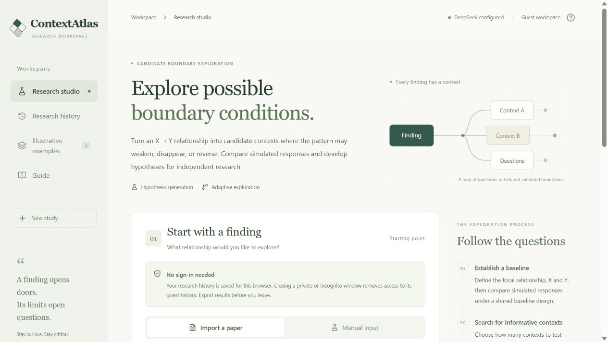
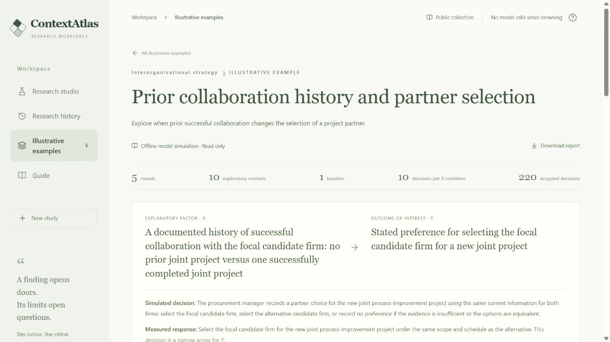

# ContextAtlas

ContextAtlas helps researchers explore where a focal relationship might change. It turns an X–Y question into a decision task, searches for informative contexts, compares model responses across two levels of X, and uses the results to guide the next search round. The output is a traceable set of candidate boundary conditions and possible follow-up studies.

**[Explore the research studio](https://contextatlas-research-studio.jzhengas.chatgpt.site/)**



This repository provides a local command-line prototype. It uses your own LLM API through the Python `openai` library, with a Node.js coordinator. All model calls are non-streaming. Agent inputs, outputs, and saved records are in English.

## From a pattern to a research question

**[See the collaboration-history exploration](https://contextatlas-research-studio.jzhengas.chatgpt.site/#examples/collaboration-history)**



The example asks when a prior successful collaboration influences partner choice. Its implications come from examining *how* the response distribution changes:

| Observed pattern in the website example | Research implication | A possible next study |
| --- | --- | --- |
| When the alternative also had one successful project, adding a focal collaboration shifted all ten responses from the alternative to equivalence. Focal selection remained zero. | A shared history can remove a disadvantage without creating a preference. The available alternatives' histories belong in the theory of partner choice. | Vary the focal and competing partners' histories jointly, and measure the full choice distribution, including equivalence. |
| Audited public-grant procurement retained the baseline's 100-percentage-point X contrast. A scoring sheet without a prior-collaboration field produced equivalence at both X levels. | The organizational channel through which experience becomes usable evidence may be more informative than formalization alone. | Cross audit requirements with the presence of an experience field on a scoring form, holding proposals and records fixed. |

The first pattern is linked to `baseline`, `r2-c1`, and `r5-c2`; the second to `r1-c1` and `r3-c3`. These are model-generated observations. The implications shown on the website are a reviewed editorial synthesis, kept separate from the original generated report. Each suggests a concrete study that could establish whether the pattern also occurs in organizational decisions. The [archived example and implications](docs/example-evidence/README.md) can be inspected without an API call.

## Quick start

You need **Node.js 22.13 or later**, **Python 3.10 or later**, and an API key for an OpenAI-compatible Chat Completions service that supports JSON-object responses. Provider support for model names and reasoning settings varies.

```bash
npm ci
python -m pip install -r requirements.txt
```

Copy `.env.example` to `.env`, then set your API key, endpoint, and model. The example configuration uses DeepSeek; you can change it for another compatible provider. Leave `LLM_REASONING_EFFORT` empty if the service does not support that parameter.

```dotenv
LLM_API_KEY=your-key
LLM_BASE_URL=https://api.deepseek.com
LLM_MODEL=deepseek-flash
LLM_REASONING_EFFORT=high
```

Run the included research question:

```bash
npm run run -- --input examples/collaboration-history.json --output runs/my-study
```

The default study has one reference context and five search rounds, with two new contexts per round and twelve decisions per X condition. The API supplies all agent responses, including planning, review, decision simulation, reflection, and reporting.

If a run is interrupted, continue from its saved checkpoint:

```bash
npm run resume -- --output runs/my-study
```

Resume uses the saved study and accepted calls. Keep the input, model settings, and runtime version consistent with that run. A proposal that fails review after two revisions stops for inspection. If a timeout leaves the provider's completion status uncertain, inspect the call record before explicitly allowing another request:

```bash
npm run resume -- --output runs/my-study --retry-uncertain
```

That flag can repeat a provider request whose earlier completion status is unknown. Schema-invalid responses stop the run; they are not automatically resampled.

## Try the software without an API

```bash
npm run demo
npm test
```

The offline demonstration uses a deterministic mock model to exercise the workflow and produce example output. It is a software check, not an experiment. The tests also run without contacting a provider.

## Start from your own question

Create a JSON input with the following fields:

```json
{
  "title": "Prior collaboration and partner choice",
  "x": "Whether the focal firm previously completed a successful project with the decision maker",
  "y": "Selection of the focal firm for a new project",
  "unit": "A procurement manager choosing a project partner",
  "context": "Two firms submit feasible proposals for the same project. The decision maker can compare the stated terms and available records.",
  "rounds": 5,
  "contextsPerRound": 2,
  "perCondition": 12
}
```

`rounds` is the search budget, from 1 to 100. `contextsPerRound` selects 1–4 of six proposed candidates. `perCondition` must be even, from 2 to 1,000, because decisions are paired with reversed presentation order. The same two X conditions and decision options are used throughout the study. Each new context is a standalone setting.

For a paper-based question, supply optional `paperTitle` and `sourceText` fields. You can first ask the extraction agent to identify supported relationships in a UTF-8 text file:

```bash
npm run extract -- --input path/to/paper.txt --output runs/extraction.json
```

Review the suggested X, Y, unit, and source excerpt, then use the chosen relationship in a study input. Convert PDFs to text before using this command. Research papers and API credentials are not included in this repository.

## What is saved

| File | Contents |
| --- | --- |
| `study.json` | Design, context candidates, accepted decisions, round reflections, and current workflow state |
| `calls/*.json` | Individual API requests and responses, including role and returned usage |
| `results.csv` | Context-level response counts, X contrasts, and order-pair diagnostics |
| `report.json`, `report.md` | Findings linked to context IDs and suggested follow-up studies |
| `manifest.json` | Run configuration and reproducibility metadata |
| `usage.json` | Recorded API usage for the run |

The request ledger contains the research text and prompts sent to the provider. Keep private study inputs and output folders out of a public repository. `.gitignore` excludes `.env`, local environments, and run outputs.

## How the search works

Seven agent roles share a structured workflow: paper extraction (optional), study design, context planning, context review, decision simulation, reflection, and reporting. A deterministic coordinator routes their outputs, validates schemas, schedules calls, computes statistics, and saves checkpoints.

1. The design agent specifies the fixed decision task, X contrast, reference context, and outcome proxy.
2. Independent actor calls establish the reference response distribution.
3. The planner proposes six contexts and selects the configured number. The reviewer checks feasibility, distinctiveness, and consistency with the fixed design.
4. Actor calls run in parallel within the configured concurrency limit. They receive only the task, facts, and displayed options.
5. The coordinator summarizes the results. The reflection agent updates the search memory, and the next round builds on those lessons.
6. After the round budget is reached, the reporting agent connects the observed patterns to follow-up research designs.

The planner sees prior contexts, predictions, results, and strategy lessons. Actors see none of that memory. Option labels are assigned reproducibly for each block, and paired calls reverse presentation order while preserving the option identity across X conditions. Actors can choose either action, report equivalence, or report insufficient information. Their short justifications cite supplied fact IDs.

See [Architecture](docs/ARCHITECTURE.md), [Measurement](docs/MEASUREMENT.md), and [Prompts](docs/PROMPTS.md) for the full protocol.

## Budget and interpretation

With `R` rounds, `K` contexts per round, and `n` decisions per X condition, the actor budget is `2 × n × (1 + R × K)`. The default study uses **264 actor calls**, plus 17 design, planning, review, reflection, and report calls: **281 API calls** before optional extraction, revisions, and retries. Token consumption depends on the model and responses; actual returned usage is recorded.

The main measure is the difference in designated-action selection between X1 and X0 within a context. Comparing that contrast with the reference context identifies candidate contextual changes worth examining. Equivalence and insufficient-information responses remain visible and stay in the denominator. These results describe the configured model's decisions; evaluating a proposed boundary condition in people or organizations is a subsequent research step.

The local release documents its own API workflow and settings. Archived website examples retain their original settings and results; a new run need not reproduce them.
