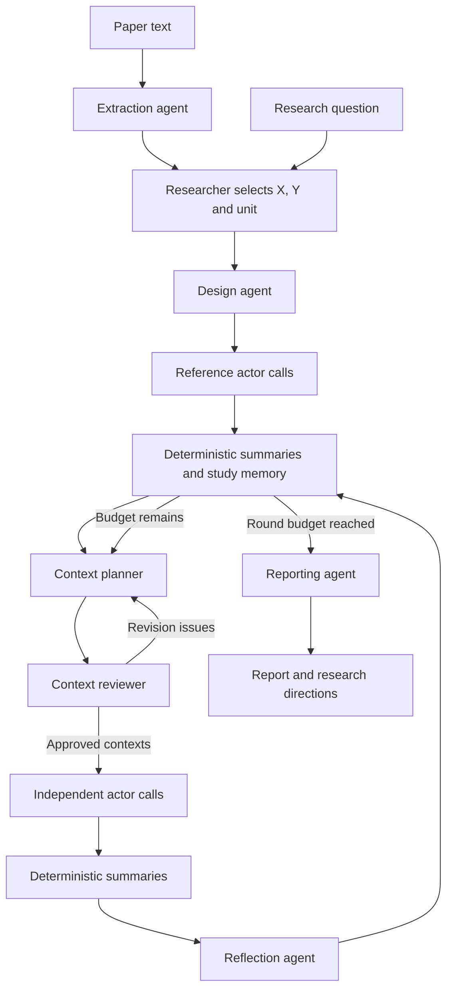

# Architecture and workflow

ContextAtlas is an adaptive research workflow for exploring candidate boundary conditions of an X–Y relationship. A researcher supplies the relationship, analytical unit, starting context, and search budget. The system constructs a fixed decision task, varies external contextual conditions, evaluates the same X contrast, and uses the accumulated results to choose the next contexts.

## Agent roles and communication

There are **seven LLM agent roles**, including optional paper extraction. A role is a prompt and output contract used in a fresh API call; it is not a persistent conversational participant. Six roles are used when the researcher enters an X–Y question directly. Multiple actor calls instantiate the same decision-simulation role.

| Role | Receives | Produces | Used by |
| --- | --- | --- | --- |
| Paper extraction | Paper text and filename | Up to three candidate X–Y relationships, units, contexts, and verbatim supporting excerpts | Researcher, who selects a relationship for study design |
| Study design | Selected X, Y, unit, context, and optional source text | Fixed task, two X levels, two actions, shared facts, reference facts, assumptions, and source notes | Planner, reviewer, actor, reflector, reporter |
| Context planning | Fixed design, completed-context results, earlier strategy lessons, source evidence, and any review feedback | Six candidates, selected IDs, predictions, inspiration, and learning value | Reviewer and coordinator |
| Context review | Fixed design, selected candidates, selection rationale, and executed-context history | Approval or specific issues linked to context IDs | Coordinator; issues return to the planner |
| Decision simulation | One task, shared facts, one context's facts, one X condition, and labeled options | Action or neutral response, short justification, and cited fact IDs | Deterministic summarizer and reflection |
| Reflection | Computed results, earlier reflections, predictions, fact-citation counts, and brief decision justifications | Observations, learned points, next questions, and strategy lessons | Planner in later rounds; final report |
| Reporting | Fixed design, executed contexts, computed results, and reflections | Summary, context-linked findings, next studies, and limitations | Researcher |

The coordinator mediates all communication. Agents do not exchange free-form messages or read files directly.

The diagram shows logical data flow. A Node.js coordinator performs routing, validation, scheduling, and storage. A Python bridge sends non-streaming requests through the `openai` library to the configured API. These are software components, not additional agents.

## Establishing the study

The researcher defines the substantive relationship and its unit. Optional extraction proposes relationships with supporting excerpts that the software checks against the supplied text. The researcher chooses a relationship before beginning the automated search.

The design agent then specifies a concrete decision task, two feasible actions, and two factual levels of X. One action is designated as the measured response. This is a decision proxy for Y; the design records its relationship to the original construct, including any conversion of continuous X into two levels. Unsupported modeling choices are recorded as assumptions.

Shared facts, the task, X0, X1, and the action definitions are fixed across contexts. Reference facts describe a complete starting setting. The coordinator checks that the X levels and actions are distinct and that the facts do not contain duplicates. It evaluates the reference condition before beginning contextual search.

## Generating and reviewing contexts

Each round requests six candidates. A candidate includes observable facts, named attributes and levels, an inspiration source, a prediction, and a statement of learning value. The planner selects the configured number of candidates. Each selected candidate replaces the reference facts in full; facts from previous contexts do not accumulate.

The planner receives completed results and earlier strategy lessons. It can revisit an unresolved question, explore a different external condition, or respond to a surprising result. There are no fixed quotas for stronger, weaker, or reversed relationships. Selection focuses on informative settings while keeping both X conditions and both actions feasible.

The coordinator rejects exact duplicate fact sets, invalid IDs, unsupported source references, and malformed responses. The review agent then checks whether selected contexts preserve the design, remain meaningfully distinct, and describe external conditions without specifying the desired response. Its checks address semantic problems beyond the deterministic checks. Rejected proposals return to the planner with specific issues; after the initial proposal and two revision attempts, the run stops for inspection if review still fails.

## Decision simulation and information separation

Each actor request is a fresh call containing only the task, shared facts, current context facts, one X condition, and displayed options. Fact IDs identify shared facts (`S1`, `S2`, ...), contextual facts (`C1`, `C2`, ...), and the current manipulation (`X`). The actor does not receive the research question, hypotheses, planner predictions, effect targets, previous decisions, computed results, or search memory.

Within a sampling block, the software assigns the two semantic actions to A/B labels and reuses that mapping under both X conditions. Two calls present the same options in opposite order. The mapping is assigned reproducibly for each block, providing controlled nuisance variation while preserving traceable action identities. Each call is separate; it is not a continuation of its paired call.

The actor returns A, B, or `NO_PREFERENCE`. A neutral answer also distinguishes equivalence from insufficient information. The coordinator maps A/B back to the designated or alternative action. A short evidence-linked justification accompanies the response; the system does not request a chain of thought.

Actor calls execute concurrently up to a configurable limit. Scheduling does not change the planned slots or make the calls independent observations of a human population.

## Measurement and reflection

The coordinator counts four outcomes for each X condition: designated action, alternative action, equivalence, and insufficient information. It computes designated-action rates, their X1-minus-X0 contrast, the contrast's change from reference, mirror agreement, and floor/ceiling flags. No LLM computes these numbers.

Reflection receives the completed round and accumulated context history. Its decision-evidence input contains the fact dictionary, counts of all cited fact IDs, and at most the first two brief justifications within each context/X/outcome group. This provides inspectable examples without presenting them as a representative sample of reasons. The reflection separates measured patterns from possible explanations and records operational lessons for the next search round.

The saved study is the persistent memory. It contains executed contexts, their predictions and results, reflections, and strategy lessons. The planner receives a structured view of that memory; the actor never does. Memory grows through accumulated records and revised search guidance, not through model-weight updates.

## Stopping, reporting, and reproducibility

The normal stopping rule is the requested round budget. A large effect or an apparently useful context does not end the search. A validation or provider failure can interrupt execution; checkpoints retain accepted work for inspection and resumption.

The report agent receives computed results and source-linked reflections. It produces an executive summary, findings linked to executed context IDs, and follow-up studies with suggested manipulations and measurements. This generated report is distinct from any later researcher-written interpretation, such as the reviewed implications displayed with the website examples.

Every API call records its prompt, payload, response, and returned usage. The run saves the study state, configuration, and reproducibility metadata. The exact prompt export is generated from the shipped engine, so the appendix and repository can be compared directly against the executed instructions. API credentials remain outside these study artifacts.

## Relationship to contextual generalization

ContextAtlas operationalizes a search across contextual attributes. It keeps a focal relationship fixed, represents settings through named attributes and concrete facts, and uses differences in simulated responses to prioritize subsequent investigation. An industry or country label alone is insufficient to specify a context: the planner must state the conditions that could matter to the decision.

The implementation is motivated by the distinction between nominal settings, contextual attributes, and mechanisms in contextual-generalization research. It is a practical search workflow rather than a numerical implementation of a published landscape model. Candidate inspiration and expected effects are planning hypotheses, kept separate from actor-facing facts and measured results.
